### A little more about me...

```json
{
  "role": "Fullstack Developer (Frontend focus)",
  "languages": ["JavaScript", "TypeScript"],
  "frontend": [
    "React.js", "Next.js", "Tanstack Query", "Redux", "HTML5", "CSS3", "Tailwind CSS", "Vite", "shadcn/ui", 
    "Ant Design", "Refine", "Zustand"
  ],
  "backend": [
    "NestJS", "Node.js", "Express.js", "Bun", "Hono", "REST API design", "GraphQL",  "WebSocket", 
    "JWT", "OAuth 2.0", "SSO", "RBAC", "Better Auth", "Auth.js" 
  ],
  "database & ORM": ["PostgreSQL", "MySQL", "MongoDB", "Redis (caching & Pub/Sub)", "Prisma", "Drizzle"],
  "architecture & practices": [
    "clean architecture", "hexagonal architecture", "vertical slice", "BFF", "design pattern",
    "code review", "mentoring"
  ],
  "cloud & devOps": ["AWS (EC2, S3, RDS, CloudFront, IAM)", "Docker", "CI/CD (github actions)"],
  "testing": [ "Jest", "Vitest", "Playwright", "Postman", "Sentry", "Biome", "Git"],
  "currently focus": "Going deeper on system design & distributed architecture"
}
```

Full Stack Developer with experience building web applications with React/Next.js, TypeScript, Node.js, and PostgreSQL. Shipped data-heavy dashboards and LLM-powered assistants. Specialize in frontend architecture, state management, and performance optimization.

### Coding activity

<!--START_SECTION:ai-coding-->
🤖 **AI Coding This Month**

```text
Lines changed: 48,885
Commits: 242

Total: 6.86B tokens · $165.08

gpt-6-luna [openai] [pi]                 5.44B  ████████████░░░  79.2%    $79.24
deepseek-v4.1-flash [opencode-go] [pi] 897.61M  ██░░░░░░░░░░░░░  13.1%     $5.45
gpt-6.1-sol [openai] [pi]              359.62M  █░░░░░░░░░░░░░░   5.2%    $60.31
gpt-6.2-sol [openai] [pi]               75.03M  ░░░░░░░░░░░░░░░   1.1%    $20.03
gpt-6.2-sol [openai] [codex]            53.06M  ░░░░░░░░░░░░░░░   0.8%       N/A
gpt-6-luna [openai] [codex]             37.08M  ░░░░░░░░░░░░░░░   0.5%       N/A
gpt-6-luna [opencode-go] [pi]            1.59M  ░░░░░░░░░░░░░░░   0.0%     $0.05
```
<!--END_SECTION:ai-coding-->

<!--START_SECTION:ai-providers-->
<!--END_SECTION:ai-providers-->

<!--START_SECTION:waka-->
**I'm an Early 🐤** 

```text
🌞 Morning                53151 commits       ████░░░░░░░░░░░░░░░░░░░░░   14.79 % 
🌆 Daytime                183746 commits      █████████████░░░░░░░░░░░░   51.12 % 
🌃 Evening                93917 commits       ███████░░░░░░░░░░░░░░░░░░   26.13 % 
🌙 Night                  28616 commits       ██░░░░░░░░░░░░░░░░░░░░░░░   07.96 % 
```
📅 **I'm Most Productive on Wednesday** 

```text
Monday                   58262 commits       ████░░░░░░░░░░░░░░░░░░░░░   16.21 % 
Tuesday                  57572 commits       ████░░░░░░░░░░░░░░░░░░░░░   16.02 % 
Wednesday                65547 commits       █████░░░░░░░░░░░░░░░░░░░░   18.24 % 
Thursday                 62534 commits       ████░░░░░░░░░░░░░░░░░░░░░   17.40 % 
Friday                   53119 commits       ████░░░░░░░░░░░░░░░░░░░░░   14.78 % 
Saturday                 28450 commits       ██░░░░░░░░░░░░░░░░░░░░░░░   07.92 % 
Sunday                   33946 commits       ██░░░░░░░░░░░░░░░░░░░░░░░   09.44 % 
```


📊 **This Week I Spent My Time On** 

```text
🕑︎ Time Zone: Asia/Saigon

💬 Programming Languages: 
TSX                      16 hrs 41 mins      ███████░░░░░░░░░░░░░░░░░░   28.11 % 
Typescript               15 hrs 7 mins       ██████░░░░░░░░░░░░░░░░░░░   25.48 % 
Markdown                 11 hrs 22 mins      █████░░░░░░░░░░░░░░░░░░░░   19.15 % 
Unknown                  10 hrs 31 mins      ████░░░░░░░░░░░░░░░░░░░░░   17.73 % 
Json                     1 hrs 57 mins       █░░░░░░░░░░░░░░░░░░░░░░░░   03.29 % 

🔥 Editors: 
Orca                     58 hrs 39 mins      █████████████████████████   98.80 % 
Codex-vscode             0 hrs 43 mins       ░░░░░░░░░░░░░░░░░░░░░░░░░   01.20 % 

💻 Operating System: 
Macos                    59 hrs 22 mins      █████████████████████████   100.00 % 
```

**I Mostly Code in TypeScript** 

```text
TypeScript               65 repos            ████████████████████░░░░░   78.31 % 
CSS                      3 repos             █░░░░░░░░░░░░░░░░░░░░░░░░   03.61 % 
Python                   3 repos             █░░░░░░░░░░░░░░░░░░░░░░░░   03.61 % 
PHP                      1 repo              ░░░░░░░░░░░░░░░░░░░░░░░░░   01.20 % 
Shell                    1 repo              ░░░░░░░░░░░░░░░░░░░░░░░░░   01.20 % 
```


<!--END_SECTION:waka-->

 Last Updated on 22/11/2026 02:01:24 UTC

### Get in touch

[Email](mailto:nguyenlehoangson2106@gmail.com) · [Instagram](https://www.instagram.com/sonn_wjh/) · [Facebook](https://www.facebook.com/profile.php?id=100011436148089)
